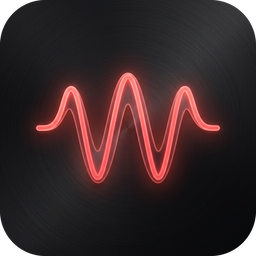
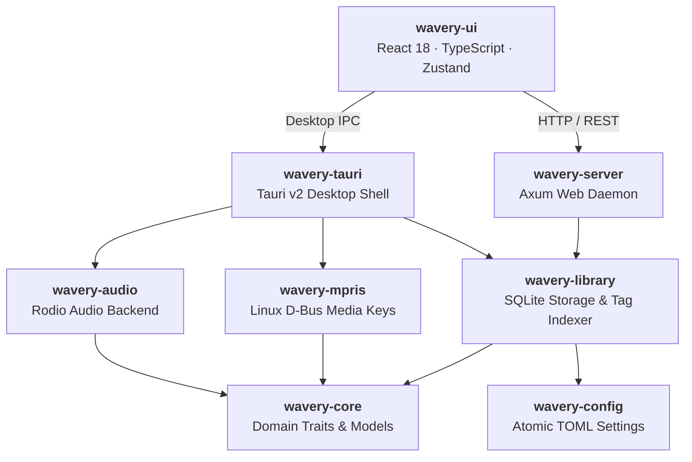

# Wavery

A fast, local-first music player that runs on your desktop or streams your audio library to any web browser. Built in Rust, Tauri v2, and React.

[](https://github.com/Arda-codes/Wavery/releases)
[](LICENSE-MIT)

---

<!-- Screenshot / UI Demo Placeholder -->
<p align="center">
  
  <br />
  <strong>Wavery Desktop & Web Audio Player</strong><br />
  <em>Local-first, gapless playback, SQLite FTS5 search, and Apple HIG aesthetic.</em>
</p>

---

## Why Wavery?

Most modern desktop music players are bloated Electron wrappers that eat 800MB of RAM just to idle in the background. Others force you into cloud accounts, subscriptions, and telemetry.

Wavery is built for people who own their music files and want a snappy, reliable player.

- **Instant search on large libraries**: Type a few letters and find any track, album, or artist immediately. The search engine uses SQLite full-text indexing (FTS5) under the hood, so collections with 50,000+ songs feel as fast as collections with fifty.
- **Low memory footprint**: The UI virtualizes every track table, keeping DOM elements constant no matter how big your library grows. The desktop shell uses native webviews through Tauri rather than bundling an entire Chromium instance.
- **Plays all your audio formats**: Full playback support for FLAC, WAV, ALAC, MP3, AAC, OGG Vorbis, and Opus files.
- **Two ways to listen**: Use the native desktop app with system tray controls and Linux MPRIS media keys, or spin up the built-in HTTP server and stream your collection to a browser on your phone, tablet, or laptop.
- **Synchronized live lyrics**: Automatically reads embedded LRC lyrics or ID3/Vorbis lyric tags and scrolls through them line by line in fullscreen mode. Click any lyric line to jump directly to that point in the song.
- **Local-first and private**: No tracking, no user accounts, and no telemetry. Everything stays stored on your local disk.

Pre-built native packages are available on the [Releases](https://github.com/Arda-codes/Wavery/releases) page:
- **Debian / Ubuntu / Pop!_OS / Linux Mint**: `.deb`
- **Arch Linux / Manjaro / EndeavourOS**: `.pkg.tar.zst`
- **Fedora / RHEL**: `.rpm`
- **Windows**: `.msi` / `.exe`
- **Cross-Platform Web Player**: Standalone server binary streaming to any modern web browser.

### Recommended Usage

Wavery is built for organizing and listening to **complete artist discographies and full albums** rather than loose, mixed single-song imports. Importing entire albums or artist folders gives you the best experience across album views, artist profiles, gapless album playback, and artwork grouping.

---

## Technical Architecture

Wavery separates its backend into modular Cargo crates governed by domain traits in `wavery-core`. Subsystems communicate through interfaces rather than concrete dependencies, keeping audio engines, databases, and network transports cleanly isolated.



### Workspace Crate Breakdown

- **`crates/core` (`wavery-core`)**: Domain models (`Track`, `Album`, `Artist`, `Playlist`) and trait contracts (`PlayerEngine`, `LibraryManager`, `MetadataReader`, `QueueManager`, `MprisBridge`). Free of concrete drivers.
- **`crates/audio` (`wavery-audio`)**: Audio playback backend powered by Rodio. Runs playback loops on a dedicated OS thread, maintains 64KB ring buffers for smooth high-bitrate playback, and handles queue transitions without resetting audio hardware state.
- **`crates/library` (`wavery-library`)**: SQLite storage with write-ahead logging (WAL) and FTS5 BM25 search ranking. Uses Lofty for reading and writing audio metadata tags (ID3v2, Vorbis Comments, FLAC, MP4), with parallel directory scanner workers.
- **`crates/server` (`wavery-server`)**: Standalone Axum daemon implementing RFC 7233 byte-range audio streaming, REST endpoints, and a memory-bounded LRU album art cache.
- **`crates/mpris` (`wavery-mpris`)**: Linux D-Bus bridge using `zbus` to integrate with desktop environments (media keys, status bars, and notification players).
- **`crates/config` (`wavery-config`)**: XDG path resolver and atomic TOML file serializer.
- **`ui/` (`wavery-ui`)**: Web and desktop interface built with React 18, TailwindCSS, Zustand stores, and `@tanstack/react-virtual`.
- **`ui/src-tauri` (`wavery-tauri`)**: Desktop composition root providing native window lifecycle, system tray menus, and IPC bridges.

---

## Compiling from Source

If you want to build Wavery yourself or contribute to development, follow the steps below.

### Prerequisites

- **Rust**: 1.80 or newer (`rustup default stable`)
- **Node.js**: 18 or newer (`npm` or `pnpm`)

On Linux, install development headers for WebKitGTK, audio, and tray support:

```bash
# Debian / Ubuntu / Pop!_OS
sudo apt-get install -y libwebkit2gtk-4.1-dev libasound2-dev libssl-dev libayatana-appindicator3-dev pkg-config

# Fedora / RHEL
sudo dnf install -y webkit2gtk4.1-devel alsa-lib-devel openssl-devel libayatana-appindicator-devel pkgconf-pkg-config

# Arch Linux
sudo pacman -S --needed webkit2gtk-4.1 alsa-lib openssl libayatana-appindicator pkgconf
```

### 1. Building the Desktop App (Tauri)

```bash
# Install frontend dependencies
cd ui && npm install

# Run desktop app in development mode
npm run tauri dev

# Build an optimized production desktop release (.deb / .rpm)
npm run tauri:build
```

Compiled desktop binaries will be placed in `ui/src-tauri/target/release/` and bundle packages in `target/release/bundle/`.

### 2. Building the Headless Server

To run Wavery as a standalone streaming server on a desktop, home server, or Raspberry Pi:

```bash
# 1. Build the web UI bundle
cd ui && npm install && npm run build
cd ..

# 2. Build the server binary
cargo build --release -p wavery-server

# 3. Run the server (defaults to port 4242)
./target/release/wavery-server
```

---

## Configuration

Settings are saved in a single TOML configuration file located at:
- **Linux**: `~/.config/wavery/config.toml` (or `$XDG_CONFIG_HOME/wavery/config.toml`)
- **Windows**: `%APPDATA%\wavery\config.toml`

Configuration updates are written atomically to temporary files before being renamed, preventing corruption if the system loses power or crashes.

---

## Running Tests

Wavery includes automated test suites covering backend audio pipelines, database transactions, concurrency, and UI state stress:

```bash
# Rust unit, integration, and stress tests
cargo test --workspace

# Strict linter verification
cargo clippy --workspace --all-targets -- -D warnings

# Frontend unit and empirical scale benchmarks
npm --prefix ui test
```

---

## Design & Artwork

I don't appreciate AI-generated design or artwork. If you are an artist or designer and want to help with icons, visual assets, or interface design, contributions are more than welcome. Feel free to open an issue or pull request.

---

## License

Dual-licensed under either the [MIT License](LICENSE-MIT) or the [Apache License 2.0](LICENSE-APACHE).
